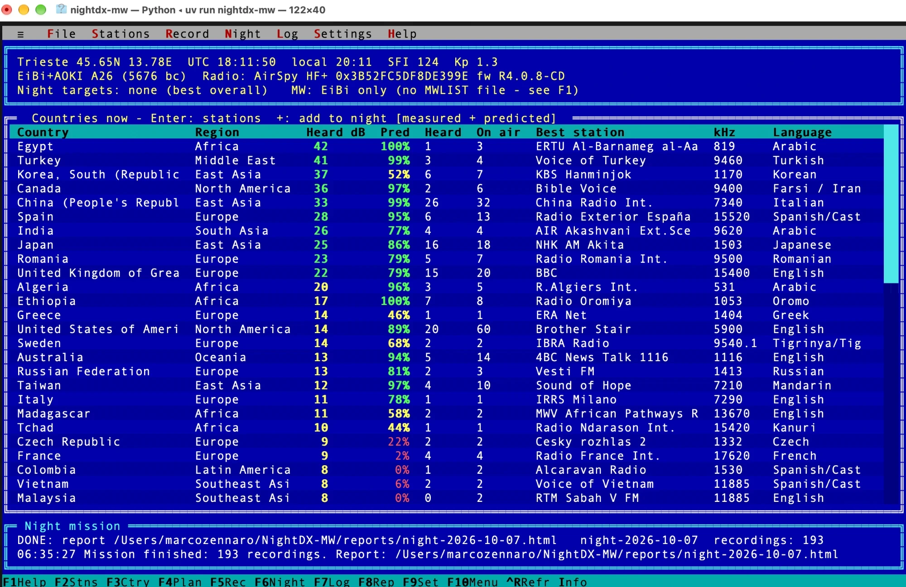
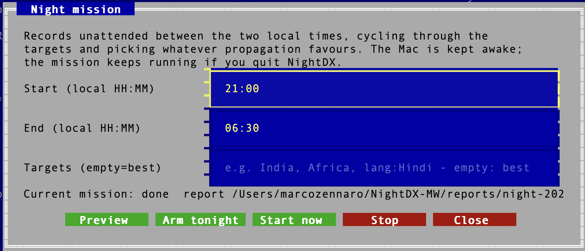
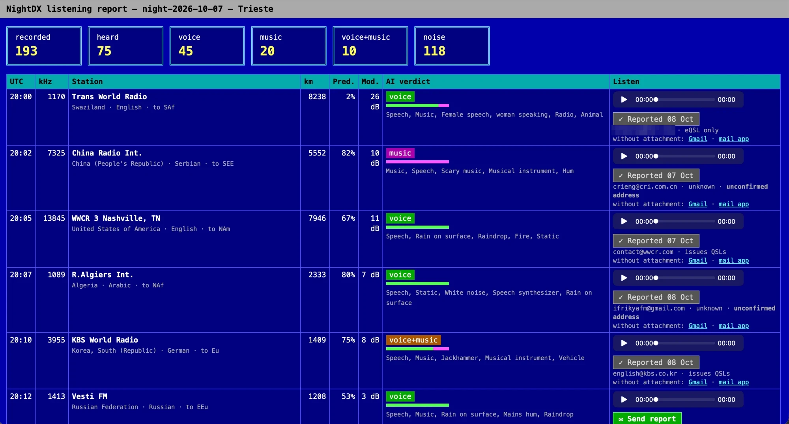

# NightDX

**Unattended shortwave and medium-wave listening with the AirSpy HF+**, in a menu-driven
terminal interface that looks like 1992.

Arm a *night mission* before going to bed. NightDX scans the bands, records the stations that
are actually coming in (preferring the ones you have never heard), works out whether each
recording holds speech, music or just noise, and in the morning gives you a report with audio
players, ready-made reception reports for the stations, and a log of the QSL cards you receive.

* **Schedules**: [EiBi](http://www.eibispace.de) + the [AOKI list](http://www1.s2.starcat.ne.jp/ndxc/)
  + the broadcasters' technical data from [HFCC](https://hfcc.org/data/) (power, beam, antenna)
  (all downloaded automatically), optionally your [MWLIST](https://www.mwlist.org) medium-wave list
  and your own list of stations.
* **Propagation**: a compact VOACAP-like HF model and an ITU-R ground/sky-wave model for MW,
  with live solar flux and Kp from NOAA - plus **self-calibration** from your own band scans.
* **Band scan**: the HF+ snapshots every band in ~10 s and measures what is really audible.
* **Night missions** with a *discovery* mode that goes after stations you haven't logged yet.
* **AI** (optional): speech / music / noise classification (AudioSet transformer) and programme
  transcription + translation (Whisper) for your reception reports.
* **Reception reports**: one click prepares an e-mail (SINPO, programme details, your QSL request)
  - as a Gmail draft with the recording attached, or in any mail program.
* **Day-by-day log** in the browser, **QSL card collection** with "already received" tracking.

## Screenshots

**Main screen** - countries ranked by what the band scan actually hears ("Heard dB") next to the
propagation prediction, with the radio, schedules and space weather at the top:



**Night mission** - choose the hours and (optionally) targets, then arm it for tonight:



**Morning report** - every recording with the AI verdict, an audio player and a reception-report
button that remembers which stations you have already written to:



## Requirements

* An **AirSpy HF+** (Discovery or Dual Port) and an antenna.
* macOS 12+, Windows 10/11, or Linux. Python is installed for you by `uv` (below).
* Internet access for schedules and space weather.

> **Status:** developed and used daily on macOS (Apple Silicon). On Windows, installation and
> first start have been confirmed with a real HF+; Linux is covered by the automatic tests.
> Reports from other setups are very welcome!

## Install on macOS

1. Install the AirSpy HF+ driver with [Homebrew](https://brew.sh):
   ```bash
   brew install airspyhf
   ```
2. Install `uv`, the Python installer (it also installs Python for you):
   ```bash
   curl -LsSf https://astral.sh/uv/install.sh | sh
   ```
   Then close and reopen the Terminal window.
3. Install NightDX:
   ```bash
   uv tool install "nightdx @ git+https://github.com/marcozennaro/nightdx"
   ```
4. Start it with `nightdx`.

## Install on Windows 10/11

Use **PowerShell** (Windows key, type `PowerShell`).

1. **Git** (uv uses it to download NightDX). Its installer needs administrator rights: click
   **Yes** when Windows asks, or run this one command in a PowerShell opened with
   *right-click > Run as administrator*:
   ```powershell
   winget install --id Git.Git -e
   ```
2. **uv** - in a *normal* (not administrator) PowerShell:
   ```powershell
   powershell -ExecutionPolicy ByPass -c "irm https://astral.sh/uv/install.ps1 | iex"
   ```
   Then **close PowerShell and open a new window** - otherwise Windows answers
   *"the term 'uv' is not recognized"*.
3. **AirSpy HF+ driver files.** They come with SDR#: download **SDR# x64**
   (`sdrsharp-x64.zip`) from [airspy.com/download](https://airspy.com/download/) and copy
   `airspyhf.dll`, `libusb-1.0.dll` and `pthreadVC2.dll` into `%LOCALAPPDATA%\NightDX\`
   (with Explorer, or with these commands if the zip is in your Downloads folder):
   ```powershell
   New-Item -ItemType Directory -Force "$env:LOCALAPPDATA\NightDX"
   Expand-Archive "$env:USERPROFILE\Downloads\sdrsharp-x64.zip" "$env:TEMP\sdrsharp" -Force
   Copy-Item "$env:TEMP\sdrsharp\airspyhf.dll","$env:TEMP\sdrsharp\libusb-1.0.dll","$env:TEMP\sdrsharp\pthreadVC2.dll" "$env:LOCALAPPDATA\NightDX\"
   ```
   Windows normally installs the HF+'s USB driver by itself; if the radio is not found, install
   the *WinUSB Compatibility Driver* from the same airspy.com page.
4. **NightDX:**
   ```powershell
   uv tool install "nightdx @ git+https://github.com/marcozennaro/nightdx"
   ```
5. Start it with `nightdx`. **The very first start can take a minute** (Windows Defender scans
   the newly installed files); later starts take a few seconds.

## Install on Linux

`sudo apt install libairspyhf-dev airspyhf libportaudio2` (or build
[airspyhf](https://github.com/airspy/airspyhf)), then steps 2-4 of the macOS instructions.

## Optional features

The setup wizard can install these later with one click, or include them from the start
(`nightdx[all]` installs all three):

```bash
uv tool install "nightdx[all] @ git+https://github.com/marcozennaro/nightdx"
```

| Extra | What it adds | Size |
|---|---|---|
| `ai` | speech/music/noise classification, programme transcription | ~2 GB + models on first use |
| `gmail` | Gmail drafts with the recording attached | ~15 MB |
| `images` | iPhone (HEIC) photos of QSL cards on Windows/Linux | ~20 MB |

## Updating

```bash
uv tool install --reinstall "nightdx @ git+https://github.com/marcozennaro/nightdx"
```

(add `[all]` after `nightdx` if you installed the extras that way). Your settings, log,
recordings and QSL cards are kept - they live in the data folder, not in the program.
See [CHANGELOG.md](CHANGELOG.md) for what's new.

Close other SDR programs while NightDX uses the radio - only one program can use it at a time.

## First start

`nightdx` opens the **setup wizard**: your location (name, country, coordinates), shortwave only
or shortwave + medium wave, a check for the radio, the optional features (with an *Install*
button), where to keep recordings, and your details for reception reports. Run it again any time
from *Settings > Setup wizard* or with `nightdx setup`.

Then press **F1** for the keys. The essentials:

| Key | | Key | |
|---|---|---|---|
| F2 | stations on the air now | F6 | night mission (arm tonight / start now) |
| F3 | most likely countries | F7 | listening log |
| F4 | preview tonight's plan | F8 | report |
| F5 / Enter | record the highlighted station | F9 | settings |
| I | why this score? | Ctrl+R | scan the bands now |

The day-by-day log, reception-report buttons and QSL cards live in your browser:
*Log > Open HTML report in browser*.

## Reception reports and Gmail

Each heard recording has a **Send report** button. Without any setup it opens a pre-filled
e-mail in Gmail or your mail program (attach the recording yourself). With the `gmail` extra
and a one-time setup, NightDX creates a real **Gmail draft with the recording attached**:

1. In the [Google Cloud console](https://console.cloud.google.com/) create a project and enable
   the **Gmail API**.
2. *OAuth consent screen*: type External; add your own address under *Test users*.
3. *Credentials > Create credentials > OAuth client ID*: type **Desktop app**; download the JSON
   and save it as `gmail_credentials.json` in your NightDX data folder (see below).
4. Run `nightdx gmail-setup` and approve. NightDX only asks to *create drafts*; it never reads
   your mail and never sends anything - you press Send.
5. Back on the consent screen (*Google Auth Platform > Audience*), click **Publish app**. While
   the app is in *Testing*, Google withdraws the permission every 7 days. Publishing needs no
   review for personal use; Google just shows an "unverified app" warning you can accept.

If the permission ever expires, the next click on **Send report** opens Google's consent page
again; approve, and the draft is created as usual.

Station addresses come from `qsl_contacts.json` (researched from station pages and DX-club QSL
logs, with sources). Add your own in `qsl_contacts.json` in the data folder; yours take precedence.

## Your own stations

*Settings > My stations list* opens `my_stations.csv` (in the data folder) in a text editor, with
instructions at the top. One broadcast per line:

```
# kHz ; UTC ; Days ; Station ; Country ; Language ; Target ; Latitude ; Longitude ; kW
1170;0000-2400;;Radio Capodistria;SVN;Italian
6070;0900-1500;Sa,Su;Radio Channel 292;D;English;Eu;48.61;11.56;10
```

Only kHz, time and station name are required. Country and language can be codes (as in EiBi) or
names; without coordinates NightDX places the transmitter in that country. Save the file and
NightDX reloads it by itself; lines it can't read are reported. Your lines take part in
predictions, scans, night missions and reports like any other, and replace a schedule entry
with the same frequency and name.

## Two or more radios

With more than one HF+ connected, *Settings > Setup wizard* shows a list of their serial
numbers: pick the one NightDX should use. (Or set `serial` under `[receiver]` in
`config.toml`, e.g. `serial = "0x3952C8F0A1B2C3D4"`.) The top line of the main screen shows
which radio is in use. If the chosen radio is not connected, NightDX says so rather than using
another one.

## Station names are candidates, not identifications

NightDX names each recording after the station the schedule lists on that frequency at that
time, ranked by the propagation model. On a crowded channel - medium wave above all - what you
actually hear may be another station. So the report shows, for every recording:

* **the evidence**: the language Whisper heard vs the scheduled language, and the measured signal
  vs the prediction. A recording is flagged *probably another station* when they disagree (e.g.
  Italian speech at 40 dB on a channel where a Korean station 8,700 km away is scheduled);
* **the other stations** scheduled on the same frequency at that time;
* **the carriers** in the recording, measured to about 0.01 Hz (e.g. *carrier +10.35 Hz; also
  -0.34 Hz (-17 dB)*). On MW these offsets are a fingerprint of each transmitter: compare them
  with other DXers' logs. They are relative to your radio's frequency standard - if you know its
  error, set `freq_correction_ppm` under `[receiver]` in `config.toml`.

NightDX asks before preparing a reception report for a flagged recording. Listen first: the
identification is yours to make.

## Medium wave and MWLIST

EiBi and AOKI cover international MW broadcasters. For the full picture, register (free) at
[fmlist.org](https://www.fmlist.org), log in at [fmscan.org](https://www.fmscan.org), set your
location, and download *Tools > Userlist for Perseus / ELAD / Winradio / SDR Console*
(LW/MW/SW, CSV, separator Tab). Put the file in the `mwlist` folder inside the data folder and
press Ctrl+U. MWLIST data is for personal, non-commercial use.

## Troubleshooting

* **"'uv' is not recognized"** (Windows) - close PowerShell and open a new window after
  installing uv.
* **Nothing happens after typing `nightdx`** - the first start after installing can take a
  minute, especially on Windows. NightDX prints *"Starting NightDX..."* right away.
* **"The HF+ was not found"** - check that the radio is plugged in and that no other SDR program
  (SDR#, SDR++, HDSDR...) is running. On Windows, check that the three DLL files are in
  `%LOCALAPPDATA%\NightDX\`, or install the WinUSB driver from airspy.com.
* **Windows asks for administrator rights** - only the Git installation needs them; install
  uv and NightDX in a normal PowerShell.
* Something else? Open an issue with the message you see.

## Where your data lives

Nothing is stored in the program folder:

| | macOS | Windows | Linux |
|---|---|---|---|
| settings, log, schedules, Gmail token, QSL cards | `~/Library/Application Support/NightDX` | `%APPDATA%\NightDX` | `~/.local/share/NightDX` |
| recordings (changeable in the wizard) | `~/Documents/NightDX/recordings` | `Documents\NightDX\recordings` | `~/Documents/NightDX/recordings` |

Set `NIGHTDX_HOME` to use another data folder.

## Command line

Everything also works without the interface (handy for cron / Task Scheduler):

```bash
nightdx update                 # schedules + space weather
nightdx best -n 20             # what's on the air now, best first
nightdx record 9420            # record a frequency now
nightdx plan                   # preview tonight's mission
nightdx night --now --end 06:30
nightdx report
```

## How it works (short version)

* **Transmitters** - for about two thirds of the shortwave broadcasts, the HFCC data gives
  the real power, beam direction and antenna type (matched to EiBi by frequency, time and site).
  Tested on ~1,000 recordings, it made the predictions clearly better; HFCC lines that EiBi
  doesn't confirm are not added, as not everything registered goes on the air.
* **Propagation** - great-circle path in F2 hops; foF2 follows local time, solar flux and Kp;
  MUF from hop geometry; George & Bradley D-layer absorption; ITU-R P.372 noise. MW uses an
  ITU-R P.368 ground-wave fit and the ITU-R P.1147 sky-wave formula. After every band scan the
  difference between prediction and measurement is learned: a receiver-wide part (antenna, local
  noise) for all stations plus a limited per-station part on shortwave, per station on MW.
* **Band scan** - 768 kHz snapshots (~0.5 s each) straight from libairspyhf; each scheduled
  carrier is compared with the local noise floor.
* **Recording** - AM demodulation from the IQ stream, saved as FLAC with full station metadata.
* **AI** - the [AST AudioSet model](https://huggingface.co/MIT/ast-finetuned-audioset-10-10-0.4593)
  labels 10 s windows; [Whisper](https://huggingface.co/openai/whisper-small) transcribes and
  translates speech for the reception report (weak signals are left blank rather than guessed).

## Credits

Schedules: EiBi (Eike Bierwirth), AOKI list / Bi Newsletter (Nagoya DX Circle), HFCC public
data (High Frequency Coordination Conference). Space weather:
NOAA SWPC. MW data: MWLIST / FMSCAN (personal use). Models: MIT AST, OpenAI Whisper.
AirSpy HF+ driver: libairspyhf.

## License

MIT - see [LICENSE](LICENSE).
